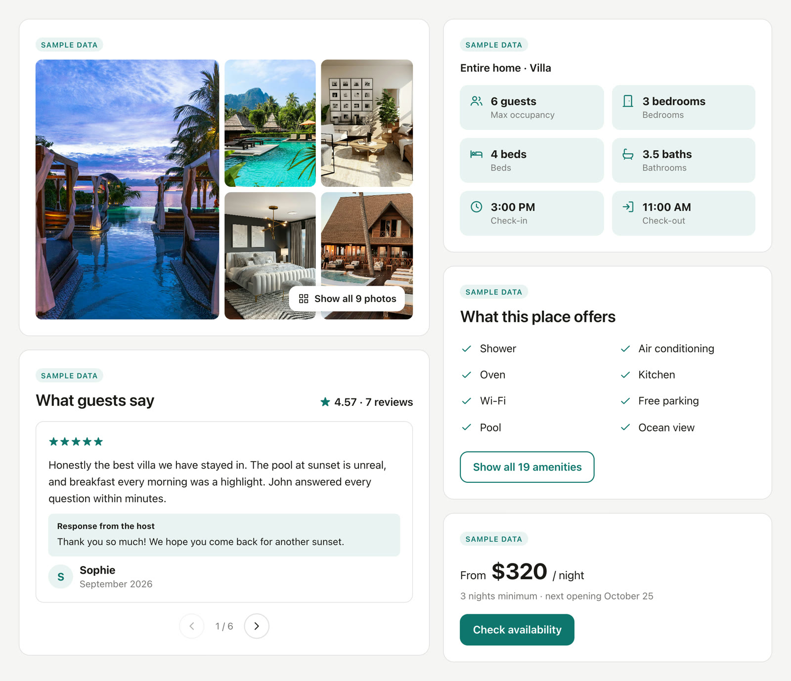
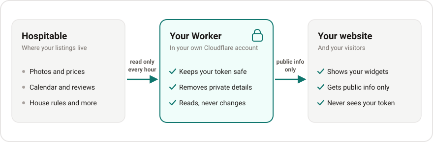

# Hospitable Listing Widgets

Show your [Hospitable](https://hospitable.com) listings on your own website: photos, amenities, reviews, an availability calendar and more. When you edit a listing in Hospitable, your website follows by itself. You don't write code or rent a server, and Cloudflare's free plan covers the cost.

<p align="center"></p>

## Is it safe?

The widgets need a key to read your listings: an access token that you create in Hospitable. The setup keeps that key, and everything private, in your hands.

<p align="center"></p>

- Your token is kept in one place: a small program in your own Cloudflare account, which Cloudflare calls a Worker. It's saved there as a secret, and once it's saved Cloudflare hides it even from you. The builder, your website and your visitors never see it.
- The token only needs Read permission, and your Worker only ever reads. It can't change a listing, touch a reservation or send a message.
- Private details are removed before anything is saved: door codes, Wi-Fi passwords, your address, guests' last names and more. [Privacy](#privacy) has the full list.
- Everything runs in accounts you own. Your Worker runs in your Cloudflare account and its code is copied into your GitHub account. The people who make this project never receive your token or your data. The builder is a web page that runs in your browser and talks to your Worker directly.
- Your website stays as it is. Each widget draws inside its own sealed box on the page, so its design can't spill onto the rest of your site, and your site's design can't break the widget.
- The code is open. Anyone can read every line of it here on GitHub.

> [!TIP]
> Don't take our word for it. Copy the prompt below, paste it into ChatGPT or Claude, and ask for its opinion. Use a version that can browse the web, so it can open the code.

```text
Please check whether this open-source project is safe for me to use:
https://github.com/agmadt/hospitable-widgets

I'm a vacation rental host, not a programmer. Open the project and read
the actual code, especially src/hospitable.js, src/normalize.js,
src/index.js, src/listings.js and widget/widget.js. Then answer in plain
language:

1. Where is my Hospitable access token kept? Could it ever reach my
   website, my visitors, the builder website or anyone else?
2. Does the code only read from Hospitable, or can it change anything,
   such as listings, reservations, messages or payments?
3. Which information about my properties becomes public? Is anything
   private included, such as door codes, Wi-Fi passwords, my address or
   guest details?
4. Could the code I paste into my website harm my site or my visitors?
   Does it track visitors or set cookies?
5. Which outside services are involved, and what does each one receive?
6. Could any of this cost me money?

End with a short verdict: would you install it, and what should I watch
out for?
```

## What you need

- A Hospitable plan with API access (the Host plan or higher).
- A free Cloudflare account and a free GitHub account. You can sign up for both with Google.
- A website that lets you add your own HTML. Wix, Squarespace, WordPress and Webflow do, though some of their plans don't: Squarespace needs a plan that allows JavaScript, and WordPress.com needs the Business plan or higher.

## How fresh the data is

Your Worker copies your listings from Hospitable once an hour. When someone visits your site, their browser keeps what it got for 4 hours, so moving between your pages doesn't ask your Worker again.

So when you change something in Hospitable, such as a price, a photo or a booked night, anyone who opens your site an hour or more after the change sees it. Someone who opened your site before that may keep seeing the old version for up to 4 more hours, so the slowest case is about 5 hours after your change.

Bookings themselves happen in Hospitable, which always has the current calendar. To show changes to returning visitors sooner, lower `CACHE_MINUTES` (see [Settings](#settings)); their browsers then ask your Worker more often.

## What it costs

For most hosts, nothing.

Cloudflare's free plan allows 100,000 requests a day. A visitor uses one request per property, and their browser then reuses it for 4 hours, however many pages and widgets they look at. That's room for roughly 100,000 different visitors a day, and every Cloudflare account has its own allowance. The widget code itself comes free from jsDelivr, a public service for open-source code, and doesn't count.

If you ever go over, you aren't charged. Your widgets pause until the allowance resets at midnight UTC: returning visitors still see the copy saved in their browser, and new visitors see a short "can't be shown right now" message.

For more traffic, Cloudflare's Workers Paid plan costs $5 a month and includes 10 million requests a month. It's also the plan to pick if you have about 40 properties or more.

## Requirements

A few things in Hospitable and on your website decide what the widgets can show:

- Your properties are listed in Hospitable. Unlisted properties are left out.
- Your photos are turned on for the Direct channel (in Hospitable, Property → Details). If they aren't, the gallery only shows the cover photo.
- Your website can run JavaScript inside an embed or code block: a Wix Embed HTML element, a Squarespace Code block, a WordPress Custom HTML block, a Webflow Code Embed, or any page whose HTML you control.
- The Local guide widget only shows the Knowledge Hub topics you choose in `PUBLIC_GUIDE_TOPICS` (see [Settings](#settings)). Until you choose some, it stays empty, because those topics often contain door codes.
- On the free plan, up to about 10 properties refresh every hour. With more, they take turns, and each one still refreshes several times a day. From about 40 properties, use the Workers Paid plan and set `SUBREQUEST_BUDGET` to `900`.
- Your visitors can open `workers.dev` addresses. Some internet providers block all of them (XL in Indonesia, for one). If many of your guests use such a provider, give your Worker an address on your own domain, managed in Cloudflare: see [Your own domain](#your-own-domain).

## Set it up

The easiest way is to follow the [builder](https://hospitable-widget.adhityoagam.com/). It takes you through these same steps one at a time and shows a live preview of your widget as you go. The steps are written out below too, if you'd like to read them first.

1. Open the [builder](https://hospitable-widget.adhityoagam.com/) and pick a widget, then its colors, fonts and layout. You can do this before anything else: it uses sample data until you connect. Your design is saved in your browser.
2. In Hospitable, go to Apps → API access → Access tokens. Add a token with Read permission and copy it. A token lasts one year.
3. Click [](https://deploy.workers.cloudflare.com/?url=https://github.com/agmadt/hospitable-widgets) (the builder has the same button). Sign in to Cloudflare and GitHub, paste your token into the `HOSPITABLE_PAT` box and click Deploy. Cloudflare sets up your Worker, including the hourly refresh.
4. When Cloudflare is done, click your Worker's address. It looks like `https://hospitable-widgets.<your-name>.workers.dev`, and you'll find it on the success page and in your Cloudflare dashboard. It opens the builder already connected, and the builder tab you were using connects too.
5. Pick one of your properties. The preview now shows your real listing.
6. Copy the snippet and paste it into your website. The builder shows how for Wix, Squarespace, WordPress, Webflow and other sites.

On Wix, that means Add Elements (+) → Embed Code → Embed HTML, then Enter Code, paste and Update. Wix doesn't resize embeds by itself, so drag the box to the height the builder suggests, in both the desktop and the mobile view.

### More than one widget

Design each widget in the builder and copy its snippet. Each snippet is two lines: a `<div …>` line that places the widget, and a `<script …>` line that loads the widget code.

- On WordPress, Squarespace, Webflow or your own HTML, paste each snippet where that widget should appear. The `<script …>` line is only needed once per page, and pasting it again does no harm.
- On Wix, every Embed HTML box is a separate little page that can't see the others, so each box needs its whole snippet. Two widgets that sit one under the other can share a box: paste the `<div …>` line of each, and the `<script …>` line once.

More widgets don't cost more. All widgets of the same property share one request to your Worker, and the visitor's browser reuses it on your other pages and in your other Wix boxes. That request carries all of the property's data, so a page with only a Description widget also downloads its calendar and reviews: about 4.5 KB instead of 2 KB with the sample data, and more for a listing with hundreds of reviews. The Property list widget asks for a different list, so it makes one request of its own.

### If something goes wrong

| What you see | What to do |
| --- | --- |
| The gallery only shows the cover photo | Turn your photos on for the Direct channel in Hospitable, under Property → Details. |
| Right after your first deploy, your Worker's address shows a security error, such as `ERR_SSL_VERSION_OR_CIPHER_MISMATCH` | On a new Cloudflare account, Cloudflare needs time to prepare the security certificate for your `workers.dev` address. In one test it took more than half an hour. Wait, then open the address again. |
| Your Worker's address doesn't open at all, for you or for some visitors | Your internet provider may block `workers.dev` addresses. Give your Worker [your own domain](#your-own-domain). |
| The Local guide widget is empty | Choose the topics it may show in `PUBLIC_GUIDE_TOPICS` (see [Settings](#settings)). |
| The builder says Hospitable rejected your token | Tokens expire after a year. Create a new one in Hospitable and replace `HOSPITABLE_PAT` (see [Settings](#settings)). |
| A widget says "This content can't be shown right now" | Your Worker couldn't be reached, or the day's free allowance is used up. Check that your Worker's address opens. A used-up allowance comes back at midnight UTC. |

## Privacy

Anyone who knows your Worker's address can read what it hands out, just as anyone can read your website. So your Worker only stores and hands out what is meant for guests. Whatever a widget asks for, it never stores or shares:

- your street address, postcode or map coordinates
- Wi-Fi name and password, guest access and check-in instructions, the house manual and "other details"
- iCal import and export links, and calendar notes
- private review feedback, detailed review comments and guests' last names
- your email, billing address and tax details, listing emails, and internal property names and tags
- anything from reservations, guests, messages, transactions or payouts (your Worker never even asks Hospitable for those)

Knowledge Hub topics often hold door codes, so your Worker shares none of them until you name the safe ones in `PUBLIC_GUIDE_TOPICS`.

For your visitors:

- The widgets set no cookies and don't track anyone.
- To show a widget, a visitor's browser connects to your Worker (for the listing), to jsDelivr (for the widget code), to the servers where Hospitable keeps your photos, and to Google Fonts if you picked a Google font.
- The browser keeps a copy of the listing data, so the widget still shows if your Worker can't be reached.

## Settings

Change these in Cloudflare under Workers & Pages → hospitable-widgets → Settings → Variables and Secrets. The deploy page only asks for `HOSPITABLE_PAT`; add the others whenever you need them. They stay in place when your Worker is updated.

| Name | What it does | If you leave it out |
| --- | --- | --- |
| `HOSPITABLE_PAT` | Your Hospitable token, with Read permission. It's a secret, so Cloudflare hides its value. Type `dummy` instead to try everything with sample data. | Required |
| `PUBLIC_GUIDE_TOPICS` | The Knowledge Hub topics the Local guide widget may show, by name and separated by commas, for example `Local attractions, Where to eat`. | No topics are shown |
| `CACHE_MINUTES` | How long a visitor's browser keeps widget data, from `0` (not at all) to `1440` (a day). Lower shows your changes to returning visitors sooner and uses more of your allowance. The builder shows the value your Worker uses. | `240` (4 hours) |
| `SUBREQUEST_BUDGET` | How many calls to Hospitable one hourly refresh may make. Raise it to `900` on the Workers Paid plan. | `45` |
| `BUILDER_URL` | Where your Worker's home page sends you. | This project's builder |
| `WIDGET_URL` | The widget code your Worker's `/demo` page uses. | `/widget.js` |

The hourly refresh isn't a setting here: its schedule lives in the `wrangler.jsonc` file. If you change it in the Cloudflare dashboard instead, the next update from GitHub puts it back to hourly.

With `HOSPITABLE_PAT` set to `dummy`, your Worker runs on sample data and never contacts Hospitable. Open `https://<your-worker>/demo` to see all 16 widgets, or connect the builder to try every step.

### Your own domain

Your Worker can also answer on an address of your own, such as `widgets.yourvilla.com`. The domain has to be managed in the same Cloudflare account as your Worker.

1. In Cloudflare, open Workers & Pages → hospitable-widgets → Settings → Domains & Routes, click Add and choose Custom domain.
2. Enter the address and add it. Cloudflare creates the DNS record and the security certificate.
3. In the builder's Connect step, enter the new address. Then copy your snippets again and replace the ones on your website, because those still point to the `workers.dev` address.

### Keeping your Worker up to date

Most improvements are in the widget code, which your website loads from jsDelivr, so they reach your site without you doing anything.

Improvements to your Worker take one more step. The Deploy button made a copy of this project in your GitHub account, and Cloudflare updates your Worker whenever that copy changes. To bring the copy up to date, run this on a computer with Git, or ask someone who uses Git to do it:

```sh
git clone https://github.com/<you>/hospitable-widgets && cd hospitable-widgets
git pull https://github.com/agmadt/hospitable-widgets main
git push
```

---

Building on this project, or curious how it works inside? Read the [developer guide](docs/developers.md).

[MIT license](LICENSE). Not affiliated with or endorsed by Hospitable.
